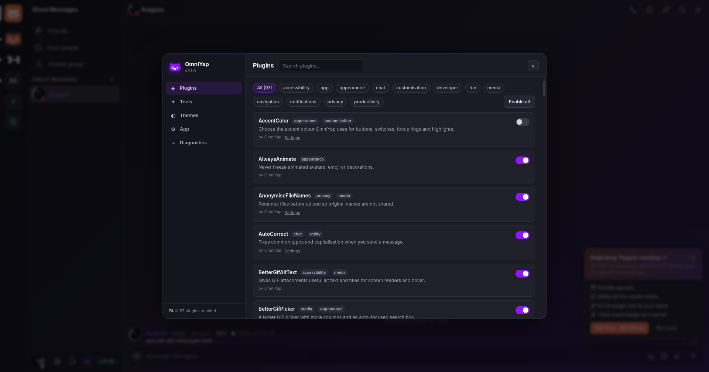

# OmniYap

**A client modification and desktop app for [Yapper](https://www.yapper.website)** — in the spirit of
Vencord/Equicord and Vesktop/Equibop, but built against Yapper's actual client.

OmniYap is an Electron window around Yapper that injects a mod runtime before the page boots. It
keeps Yapper's own desktop features (screen picker, native notifications, taskbar badge) working,
adds a Vencord-style plugin API, and ships **262 plugins** — 61 of them ports/adaptations of Equicord
plugins, plus 201 Yapper-specific tools that Equicord has no equivalent for.



**Website:** [aragasu.github.io/omniyap](https://aragasu.github.io/omniyap/) · **Downloads:** [GitHub releases](https://github.com/Aragasu/omniyap/releases)

## What works today

- **Electron app** for Windows, Linux and macOS (electron-builder targets for NSIS/portable, AppImage/deb/tar.gz, dmg/zip).
- **Mod injection at document start**, before Yapper's Turbopack runtime boots.
- **Turbopack module hook + finder** (`OmniYap.finder`) and **Vencord-style source patches**.
- **Yapper store adapter** (`OmniYap.store`) for reading channels, messages, profiles, presence and calling Yapper's own actions (`sendMessage`, `toggleReaction`, `markRead`, …).
- **Plugin manager** with typed options, enable/disable, error isolation and cleanup.
- **In-app settings UI** (plugins, tools, themes, app settings, diagnostics) on `Ctrl+,` or the OY button.
- **Native desktop bridge** (`window.OmniYapNative`) and a compatible `window.yapperDesktop` shim, so Yapper's own desktop code paths keep working.
- **Theme system**: Quick CSS, local `.css` files, https theme links.
- **Android shell** (WebView) in [`android/`](android/) — Electron cannot target Android, so this is a separate Kotlin wrapper that injects the same renderer bundle. The debug APK builds today; it is not device-tested yet.

Screenshots: [plugins](screenshots/settings-plugins.png) · [tools](screenshots/settings-tools.png) · [chat](screenshots/app-channel.png)

## Quick start

```bash
npm install
npm run build     # bundles src/renderer -> dist/renderer.js
npm start         # builds, then launches Electron
```

The app opens `https://www.yapper.website`. Log in there as usual. Press `Ctrl+,` or click **OY** in
the user bar to open OmniYap settings.

### Development

```bash
npm run dev                 # build + launch
node build.mjs --dev        # unminified bundle with inline sourcemap
node scripts/cdp.mjs "window.OmniYap.plugins.list().length"
```

`scripts/cdp.mjs` evaluates expressions in the running window (start the app with
`--remote-debugging-port=9223`). `node scripts/cdp.mjs --screenshot out.png` captures the window.
This is how the plugins were verified against the live service.

### Packaging

```bash
npm run package:linux   # AppImage, deb, tar.gz
npm run package:win     # NSIS installer + portable (run on Windows, or with Wine)
npm run package:mac     # dmg + zip (must run on macOS to sign/notarise)
```

Verified locally: the AppImage, `.deb` and `.tar.gz` build, and the packaged Linux app was launched and
reported 262 registered plugins with no plugin errors against the live site. The Windows installer and
portable builds are produced with Wine on Linux and included in the release. The macOS targets are
configured but must be built and signed/notarised on macOS.

For Android, `bash scripts/android-build.sh` provisions a project-local JDK/SDK/Gradle and produces
`android/app/build/outputs/apk/debug/app-debug.apk` (verified, 2.4 MB with the renderer bundle inside).
It has not been run on a device or emulator yet. See [docs/ANDROID.md](docs/ANDROID.md).

## Plugins

262 plugins live in [`src/renderer/plugins/`](src/renderer/plugins). Each file is a self-contained
`definePlugin({...})` module. A few highlights:

| Plugin | What it does |
| --- | --- |
| `SilentTyping` | Drops outgoing typing frames on the realtime socket |
| `MessageLogger` | Local log of edited/deleted messages with a viewer |
| `QuickSwitcher` | Fuzzy channel switcher on `Ctrl+K` |
| `ScheduleMessages` | Write now, send later |
| `VolumeBooster` | WebAudio gain up to 500% for voice and media |
| `MessageBookmarks` / `UserNotes` | Local, private, per-user/message data |
| `IrcColors` / `ShowMeYourName` / `UserMessagesPronouns` | Name and identity display |
| `ClearURLs` / `NoTrack` / `AnonymiseFileNames` | Privacy |
| `ImageZoom` / `PictureInPicture` / `MediaActions` | Media handling |
| `WebContextMenus` / `WebKeybinds` | Native desktop integration |

See [docs/PLUGIN-MATRIX.md](docs/PLUGIN-MATRIX.md) for the full audit of all 365 Equicord plugin
directories (164 base Vencord + 201 Equicord extras): 61 ported, 23 native, 67 planned, 171 blocked
on Discord internals and 43 not applicable to Yapper.

### Team badges

`StaffBadges` shows owner, developer, contributor, translator, tester and artist labels. The owner and
developer roles come from a small roster signed with a key that is not part of the app, so a fork
cannot grant itself the owner badge by editing a list; the other roles can be bound locally. See
[docs/BADGES.md](docs/BADGES.md) for the format, the signing workflow and key rotation.

YapCord lists 110 plugins, but 19 of those are legacy `Ported_*` copies of plugins OmniYap already
ships (`Ported_hideAttachments`, `Ported_pluginProfiles`, `Ported_unreadNavigator`, …), so its unique
surface is smaller than the headline number. The remaining YapCord-only ideas are mostly in the
matrix's planned column.
See [docs/ARCHITECTURE.md](docs/ARCHITECTURE.md) for how the loader works.

## Layout

```
src/main/        Electron main process: window, tray, permissions, screen picker, IPC
src/preload/     Isolated-world bridge + document-start injection
src/renderer/    Injected mod runtime (core + ui + plugins)
android/         Android WebView shell (Gradle)
docs/            Architecture, plugin matrix, Android notes
scripts/         Icon generator, CDP driver, smoke test
```

## Security notes

- `contextIsolation: true`, `sandbox: true`, `nodeIntegration: false`.
- The preload only exposes a narrow IPC surface, and every handler checks the sender's origin.
- The renderer bundle is injected into the page's main world, which is what makes it a client mod;
  it runs with the page's privileges, exactly like Vencord does in Discord.
- No credentials are bundled. The app uses Yapper's normal login.
- Official team badges are granted by a roster signed with a key held outside the repository, so
  editing the shipped roster cannot grant a badge. A rebuilt client can still draw anything it likes;
  see [docs/BADGES.md](docs/BADGES.md).

## Disclaimer

OmniYap is an unofficial third-party client modification. Yapper's Terms prohibit automating a
normal account and reverse-engineering the software; client mods occupy a grey area. Use at your own
risk, and prefer features that only change your own client. The bot API is the supported way to
automate anything.

## Licence and attribution

GPL-3.0-or-later. The loader design and plugin API are inspired by
[Vencord](https://github.com/Vendicated/Vencord) and [Equicord](https://github.com/Equicord/Equicord)
(GPL-3.0), and the Yapper-specific integration points were informed by
[YapCord](https://github.com/Jay2ez-web/YapCord) (GPL-3.0). OmniYap is an independent implementation;
plugin code here was written for OmniYap's API and Yapper's DOM.
